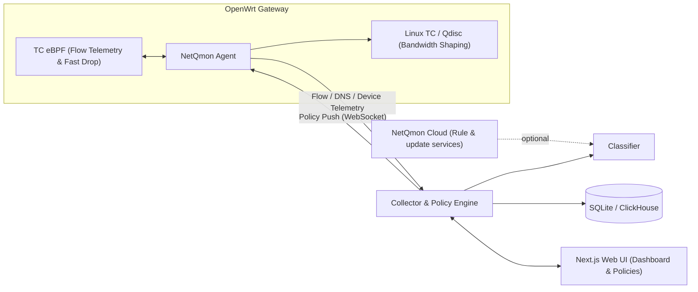

<p align="center">
  Network visibility and traffic policy engine for OpenWrt — from clients and applications to flows, destinations, and traffic control.
</p>

<p align="center">
  <strong>English</strong> · <a href="docs/README.zh-CN.md">简体中文</a>
</p>

<p align="center">
  <a href="https://demo.netqmon.com" target="_blank"></a>
  
  
  
  
</p>

<p align="center">
  
</p>

NetQmon is a self-hosted network observability and traffic policy platform built for OpenWrt. It gives you complete visibility into what is using your network, where traffic is going, and how that activity changes over time — while providing granular, application-aware traffic control and bandwidth shaping directly on the gateway.

A lightweight Agent runs on the gateway, leveraging TC eBPF for zero-overhead flow telemetry and wire-speed policy enforcement. The Controller handles high-performance storage, classification, real-time analytics, visual policy management, and simulation.

> NetQmon combines **deep network observability** with **application-aware traffic policies** (rate limiting, blocking, and scheduling via eBPF & TC). It brings actionable traffic governance to home and edge networks alongside your existing firewall without turning your router into a heavy analytics appliance.

## Screenshots

<p align="center">
  
  
</p>

## Highlights

|                            |                                                                                                                      |
|----------------------------|----------------------------------------------------------------------------------------------------------------------|
| **Clients**                | Realtime upload/download, traffic history, IP/MAC/hostname correlation, and device identity signals.                 |
| **Applications**           | Classify traffic by organization, application, category, domain, protocol, IP/ASN metadata, and bounded DPI signals. |
| **Traffic Policies**       | Application- and client-aware policy engine: blocking, upload/download bandwidth shaping (TC/eBPF), and schedules.   |
| **Flows**                  | Explore IPv4/IPv6 flows with source, destination, protocol, ports, bytes, and classification context.                |
| **Destinations**           | Understand where traffic goes with domain, country/region, ASN/ISP, and geographic views.                            |
| **Realtime + history**     | Follow current activity and query historical ranges from the same interface.                                         |
| **Simulation & Tracking**  | Dry-run policy evaluation against sample traffic before deployment, with real-time 4-stage synchronization tracking. |
| **OpenWrt-native**         | TC eBPF data plane, native `procd` service, UCI configuration, emergency CLI controls, and optional LuCI app.        |
| **Self-hosted Controller** | Docker deployment with SQLite by default and optional ClickHouse for larger datasets.                                |

## How it works



The Agent stays focused on capture, lightweight enrichment, and kernel-level policy enforcement. Heavy computational work — application classification, policy compilation and evaluation, aggregation, historical queries, and visualization — belongs on the Controller.

## Traffic Policies & QoS

NetQmon includes a declarative traffic policy engine that bridges high-level application classification with kernel-level traffic control:

- **Targeted Selection**:
  - **Clients**: Apply rules to specific devices by MAC address, IP, or hostname, or apply global gateway-wide limits.
  - **Applications & Categories**: Target identified services (e.g., video streaming, gaming, P2P/downloads, social media) or entire application categories.
  - **Confidence Threshold**: Set a minimum application identification confidence (`min_application_confidence`) to prevent false positives on early or ambiguous flows.

- **Granular Actions**:
  - **Block**: Fast-path packet dropping via TC eBPF maps (`flow_verdict_map` and dynamic `endpoint_blocks` with DNS lease correlation). Drops unwanted traffic at wire speed with minimal gateway CPU usage.
  - **Limit (Traffic Shaping)**: Independent upload and download bandwidth caps (in bps/Mbps) implemented through Linux Traffic Control (`tc` / HTB / CAKE / FQ-CoDel / IFB). Supports both per-client total bandwidth limits and fine-grained per-application shaping.
  - **Allow / Priority**: Whitelist mission-critical traffic or assign policy priorities (0–1000) to override broader restrictions.

- **Time Windows & Scheduling**:
  - Define timezone-aware schedules with recurring active windows (e.g., limit streaming bandwidth during work hours 09:00–18:00, block gaming on school nights).

- **Visual Management & Simulation**:
  - **Dual Editor**: Seamlessly switch between the intuitive visual form editor and the declarative YAML specification editor with real-time validation.
  - **Policy Verdict Preview**: Interactive dry-run simulator to test and verify how policies evaluate a sample client MAC, application, and category before applying changes to the network.
  - **4-Stage Deployment Tracking**: Full visibility into the sync lifecycle: `Desired` (Controller) → `Delivered` (WebSocket) → `Acknowledged` (Agent received) → `Applied` (Active on kernel/interfaces), with transparent reporting of degraded or unsupported states.

- **Reliability & Fail-Safe Protection**:
  - **Hardware & Link Probing**: Automatically negotiates physical interface speeds (including multi-gigabit links) or accepts explicit interface capacity overrides.
  - **Zero-Disruption Fallback**: Non-disruptive rollbacks and capability checks ensure your router never hangs.
  - **Local Emergency Unlock**: If a misconfiguration occurs, run `netqmon-agent policies unlock` directly on the router CLI to instantly tear down active policy rules and qdiscs without needing Controller connectivity.

## Quick start

### Controller

```bash
git clone https://github.com/jarvis2f/netqmon.git
cd netqmon
docker compose up -d
```

1. Open `http://localhost:3000` after the Controller becomes healthy to complete the initial administrator setup.
2. Navigate to **Settings** and click **Update GeoIP & ASN Database** to enable geographic location and ASN enrichment for destination traffic.
3. Note or configure the **Enrollment Token** (default or via environment variable) to authenticate your OpenWrt Agent.

SQLite is the default storage backend. ClickHouse can be enabled when you need higher ingest volume or longer retention.
See [Controller Configuration](docs/controller-configuration.md) for environment variables, ports, and storage options.

### OpenWrt Agent

NetQmon currently targets **OpenWrt 24.10+** on **x86_64** and **aarch64**. Linux **6.6+** is recommended; kernels **5.15+** may work when the required eBPF/TC
capabilities are available. See the [Platform Support Matrix](docs/platform-support-matrix.md) for details.

Install the required kernel modules first:

```sh
opkg update
opkg install kmod-sched-core kmod-sched-bpf
```

Then install the NetQmon Agent package and, if wanted, the LuCI app from a release. Configure the Controller address and verify the router with:

```sh
netqmon-agent doctor
```

Check policy synchronization status or manage emergency unlock directly on the router:

```sh
netqmon-agent policies status
netqmon-agent policies unlock   # Instantly remove all NetQmon policy rules and qdiscs
netqmon-agent policies resume   # Restore policy enforcement
```

See [Agent CLI Reference](docs/agent-cli-reference.md) for command-line options, policy management, diagnostics, UCI configuration, and environment variables.

## Community and Pro

NetQmon Community and Pro use the same monitoring engine, policy framework, and web interface. The difference is the classification data available to them.

| Edition       | Classification data                                                                                                          |
|---------------|------------------------------------------------------------------------------------------------------------------------------|
| **Community** | Community rule dataset suitable for common applications and services.                                                        |
| **Pro**       | A larger, continuously maintained dataset delivered through NetQmon Cloud for broader application and organization coverage. |

Pro extends recognition coverage; it does not unlock a different capture engine or a separate set of monitoring features.

More information is available at [netqmon.com](https://netqmon.com).

## Privacy

NetQmon is designed for traffic metadata and network observability, not content inspection. Protocol identification may use small, bounded samples from the
beginning of a flow when needed. NetQmon does not decrypt TLS.

The standard deployment keeps the Controller and traffic database on infrastructure you operate.

See [Privacy](docs/PRIVACY.md) for the implementation details and probe limits.

## Project layout

```text
bpf/                         TC eBPF data plane & fast-path policy enforcement maps
crates/agent/                OpenWrt userspace Agent (telemetry & policy executor)
crates/collector/            Ingestion, DPI, policy engine, realtime and query pipeline
crates/classifier-client/    Classification client
crates/classifier-manager/   Rule lifecycle and updates
crates/storage/              SQLite / ClickHouse storage
apps/controller-ui/          Next.js Controller UI & Policy dashboard
packaging/openwrt/           OpenWrt packages and LuCI app
deploy/docker/               Controller container build
docs/                        Architecture, deployment, CLI and protocol docs
```

## Development

Backend:

```bash
cargo test --workspace
```

Controller UI:

```bash
pnpm install
pnpm lint
pnpm typecheck
pnpm build
pnpm e2e
```

## License

NetQmon is licensed under the [Apache License 2.0](LICENSE).

---

<p align="center">
  <a href="https://demo.netqmon.com">Live Demo</a>
  ·
  <a href="https://netqmon.com">Website</a>
  ·
  <a href="https://github.com/jarvis2f/netqmon/releases">Releases</a>
</p>
