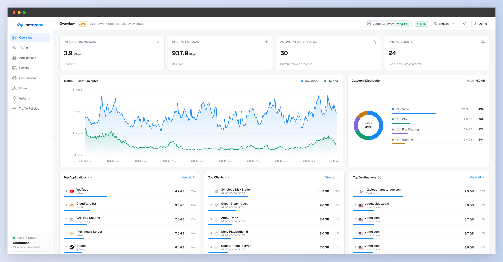
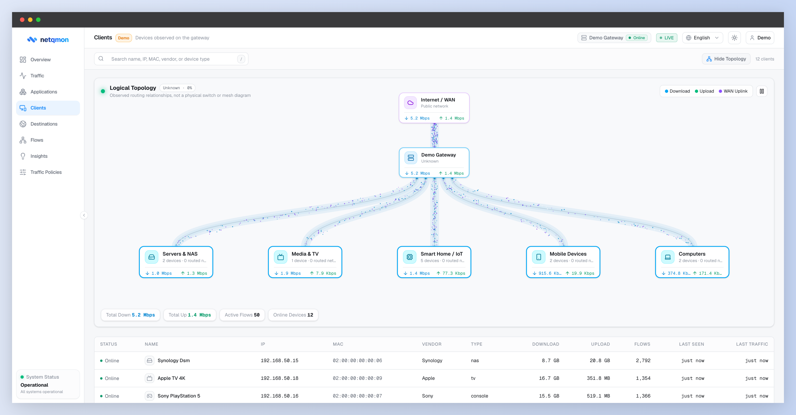
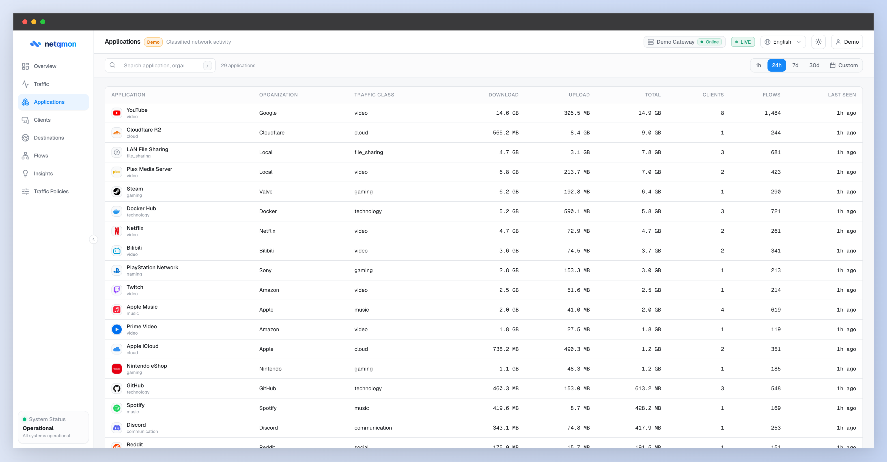
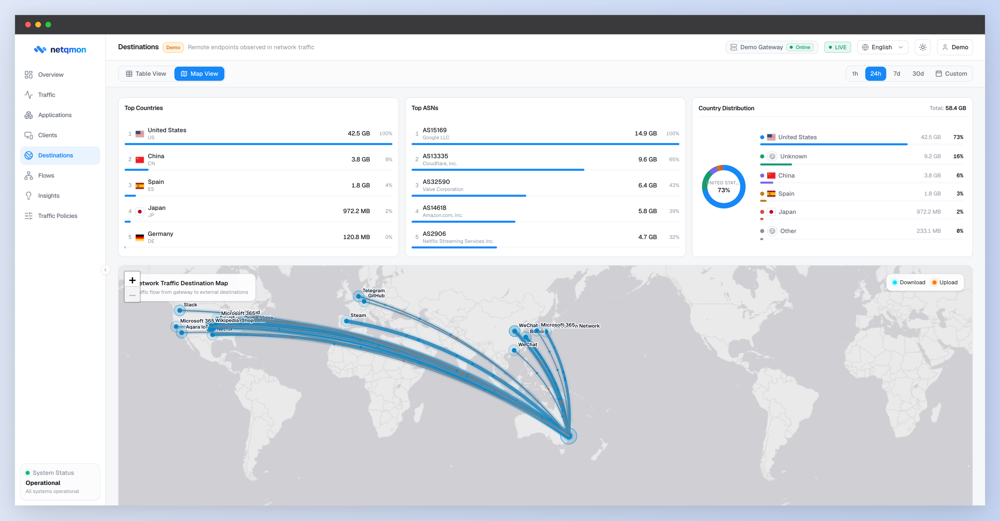
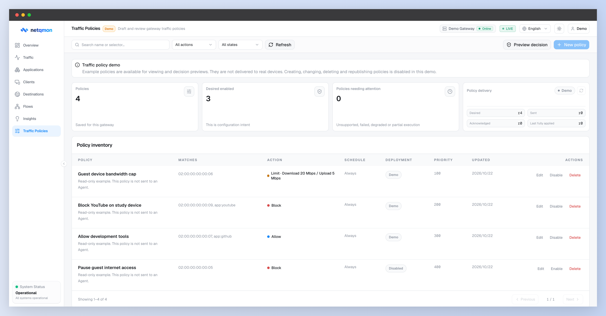
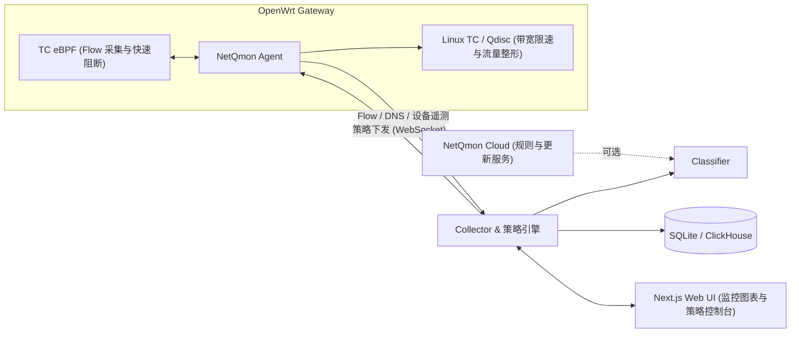

<p align="center">
  为 OpenWrt 提供清晰的网络可观测与流量策略治理能力，从客户端、应用到 Flow、目的地与 QoS 控制。
</p>

<p align="center">
  <a href="../README.md">English</a> · <strong>简体中文</strong>
</p>

<p align="center">
  <a href="https://demo.netqmon.com" target="_blank"></a>
  
  
  
  
</p>

<p align="center">
  
</p>

NetQmon 是一个面向 OpenWrt 的自托管网络可观测与流量策略管理平台。它不仅让你清晰掌握网络中“谁在使用流量、访问了什么服务、流量去向何处以及随时间的变化趋势”，还能基于应用识别与设备身份，在网关本地执行精细化的流量控制、带宽限速与分时段计划调度。

轻量级 Agent 运行在网关上，通过 TC eBPF 实现极低开销的 Flow 遥测采集与线速策略执行；Controller 负责存储、应用分类、实时监控、历史分析、策略编译与控制台管理。路由器专注于数据面执行，复杂分析与策略编译由 Controller 承载。

> NetQmon 将 **深度网络可观测** 与 **应用感知流量策略**（基于 eBPF 与 TC 的阻断、限速整形及计划调度）深度结合，在不加重路由器负担的前提下，为家庭与边缘网络提供兼具清晰度与掌控力的流量治理方案。

## 截图

<p align="center">
  
  
  
  
  
</p>

## 核心能力

| | |
| --- | --- |
| **客户端** | 查看实时上传/下载、历史流量，并关联 IP、MAC、hostname 与设备识别信息。 |
| **应用识别** | 综合组织、应用、分类、域名、协议、IP/ASN 元数据以及有限 DPI 信号进行流量分类。 |
| **流量策略** | 基于应用、分类与客户端的策略引擎：支持精准阻断、双向限速整形（TC/eBPF）、优先级与时间调度。 |
| **Flow** | 查询 IPv4/IPv6 Flow，查看源/目的地址、协议、端口、流量与分类上下文。 |
| **目的地** | 从域名、国家/地区、ASN/ISP 和地理视图理解流量去向。 |
| **实时与历史** | 在同一个界面观察当前网络活动，并查询不同时间范围的历史数据。 |
| **仿真与生命周期** | 支持下发前预览判决仿真评估，端到端追踪期望、发送、确认与生效（Desired → Applied）4 阶段状态。 |
| **OpenWrt 原生体验** | TC eBPF 数据面、`procd` 服务、UCI 配置、诊断与紧急避险命令，以及可选的 LuCI 界面。 |
| **自托管 Controller** | 通过 Docker 部署；默认使用 SQLite，也可以选择 ClickHouse 承载更大规模的数据。 |

## 工作方式



Agent 专注于高效流量采集、轻量富化与内核级策略执行（eBPF / TC）。应用深度识别、策略编译与规则推导、时序聚合、历史查询与可视化等高计算量任务由 Controller 集中处理，在赋予网关强大控制力的同时，避免给路由器带来性能负担。

## 流量策略与 QoS

NetQmon 内置声明式流量策略引擎，将上层的应用识别能力与底层的内核级流量控制（eBPF & TC）打通，实现“看得清，管得住”：

- **多维目标匹配**：
  - **客户端**：支持按 MAC 地址、IP、hostname 指定设备，或配置网关全局聚合限速。
  - **应用与分类**：支持针对已识别的具体应用（如视频流媒体、在线游戏、P2P 下载、网盘等）或应用大类配置规则。
  - **置信度门限**：可自定义应用识别最低置信度（`min_application_confidence`），防止在连接初期的模糊流上误判。

- **丰富的控制动作**：
  - **阻断（Block）**：基于 TC eBPF Map（`flow_verdict_map` 与关联 DNS 解析学习的 `endpoint_blocks` 租期表）在线速快速路径上直接丢弃，无需每次经过用户态，CPU 开销极低。
  - **限速整形（Limit）**：支持独立的上行与下行带宽限制（bps/Mbps），底层采用 Linux Traffic Control（`tc` / HTB / CAKE / FQ-CoDel 与 IFB 重定向）。既支持客户端整机总带宽限制，也支持具体应用的细粒度限速。
  - **放行与优先级（Allow / Priority）**：支持核心业务优先放行，策略支持优先级权重（0–1000），确保精细化规则正确覆盖宽泛规则。

- **计划调度与生效时间**：
  - 支持绑定时区的时间窗口计划（Schedule），可灵活设定生效星期（周一至周日）与具体时间段（如工作日 09:00–18:00 限速影音娱乐，深夜阻断网络游戏）。

- **可视化管理与仿真预览**：
  - **双模编辑器**：支持可视化表单与标准 YAML 声明式定义双向同步切换与即时校验。
  - **策略判决预览（仿真评估）**：提供交互式 Dry-run 预览工具，在规则下发前输入客户端 MAC、应用与分类，即时查看命中判决结果，杜绝误配。
  - **4 阶段下发状态机**：端到端追踪策略同步生命周期：`期望（Desired）` → `已发送（Delivered）` → `已确认（Acknowledged）` → `已完整应用（Applied）`，支持降级、部分生效与错误原因透明排查。

- **可靠性与容灾保护**：
  - **接口速率自适应**：自动协商物理接口速率（支持 2.5G/10G 等多千兆速率），亦可手动声明链路容量。
  - **能力协商与降级保护**：Agent 自动探测网关内核能力（eBPF Map、tc qdisc、mark 标记等），不满足条件时优雅报告降级，避免网络异常。
  - **本地紧急避险指令**：如遇极端误配导致网络异常，可在 OpenWrt 终端执行 `netqmon-agent policies unlock` 立即一键清空所有生效的策略规则与 qdisc 队列，迅速恢复网络畅通，后续可使用 `netqmon-agent policies resume` 恢复。

## 快速开始

### Controller

```bash
git clone https://github.com/jarvis2f/netqmon.git
cd netqmon
docker compose up -d
```

1. Controller 健康检查通过后，在浏览器访问 `http://localhost:3000`，按照引导完成管理员初始化设置。
2. 登录后前往 **「设置」** 页面，点击执行 **「更新地理位置与 ASN 数据库」**，以启用目标国家/地区与 ASN 归属分析。
3. 确认你在 `docker-compose.yml`（或环境变量）中配置的接入令牌（**Enrollment Token**），后续配置 OpenWrt Agent 接入时将用到此令牌。

默认使用 SQLite 作为存储后端。在需要更高写入吞吐或更长数据保留期时，可以启用 ClickHouse。详细环境变量、端口与存储配置见 [Controller 配置与端口说明](controller-configuration.zh-CN.md)。

### OpenWrt Agent

NetQmon 目前优先支持运行在 **x86_64** 和 **aarch64** 架构上的 **OpenWrt 24.10+**。推荐 Linux **6.6+** 内核；在满足对应 eBPF/TC 能力时，**5.15+** 内核也可能可用。平台支持详情见 [平台支持矩阵](platform-support-matrix.md)。

先安装所需的内核模块：

```sh
opkg update
opkg install kmod-sched-core kmod-sched-bpf
```

随后从 Release 安装对应架构的 NetQmon Agent；如需要，也可以同时安装 LuCI 应用。配置 Controller 地址后，可使用下面的命令检查运行环境：

```sh
netqmon-agent doctor
```

在网关本地查看策略生效状态或执行紧急避险：

```sh
netqmon-agent policies status
netqmon-agent policies unlock   # 紧急避险：立即清空所有 NetQmon 策略规则与 qdisc 队列
netqmon-agent policies resume   # 恢复策略执行
```

完整命令行选项、策略管理、诊断工具、UCI 配置与环境变量说明见 [Agent 命令与配置参考](agent-cli-reference.zh-CN.md)。

## Community 与 Pro

Community 和 Pro 使用同一套 NetQmon 监控能力、策略框架与管理界面，两者的区别主要在于流量识别规则数据。

| 版本 | 规则数据 |
| --- | --- |
| **Community** | 面向常见应用和服务的社区规则数据集。 |
| **Pro** | 通过 NetQmon Cloud 提供规模更大、持续维护的规则数据集，以覆盖更多应用和组织。 |

Pro 扩展的是识别覆盖率，并不是另一套采集引擎，也不会把基础监控或策略功能拆成单独的付费功能。

更多信息见 [netqmon.com](https://netqmon.com)。

## 隐私

NetQmon 的目标是网络可观测与受控治理，而不是内容审查。协议识别在必要时可能读取连接开始阶段少量且受限的数据样本，但不会解密 TLS。

标准部署方式下，Controller 与流量数据库运行在你自己管理的设备或服务器上。

具体实现与采样限制见 [Privacy](docs/PRIVACY.md)。

## 项目结构

```text
bpf/                         TC eBPF 数据面与线速策略执行 Map
crates/agent/                OpenWrt userspace Agent（遥测采集与策略执行器）
crates/collector/            数据接收、DPI、策略引擎、实时与查询管线
crates/classifier-client/    分类客户端
crates/classifier-manager/   规则生命周期与更新
crates/storage/              SQLite / ClickHouse 存储
apps/controller-ui/          Next.js Controller UI 与策略管理控制台
packaging/openwrt/           OpenWrt 软件包与 LuCI 应用
deploy/docker/               Controller 容器构建
docs/                        架构、部署、CLI 与协议文档
```

## 开发

后端：

```bash
cargo test --workspace
```

Controller UI：

```bash
pnpm install
pnpm lint
pnpm typecheck
pnpm build
pnpm e2e
```

## License

NetQmon 使用 [Apache License 2.0](LICENSE)。

---

<p align="center">
  <a href="https://demo.netqmon.com">在线 Demo</a>
  ·
  <a href="https://netqmon.com">网站</a>
  ·
  <a href="https://github.com/jarvis2f/netqmon/releases">Releases</a>
</p>
